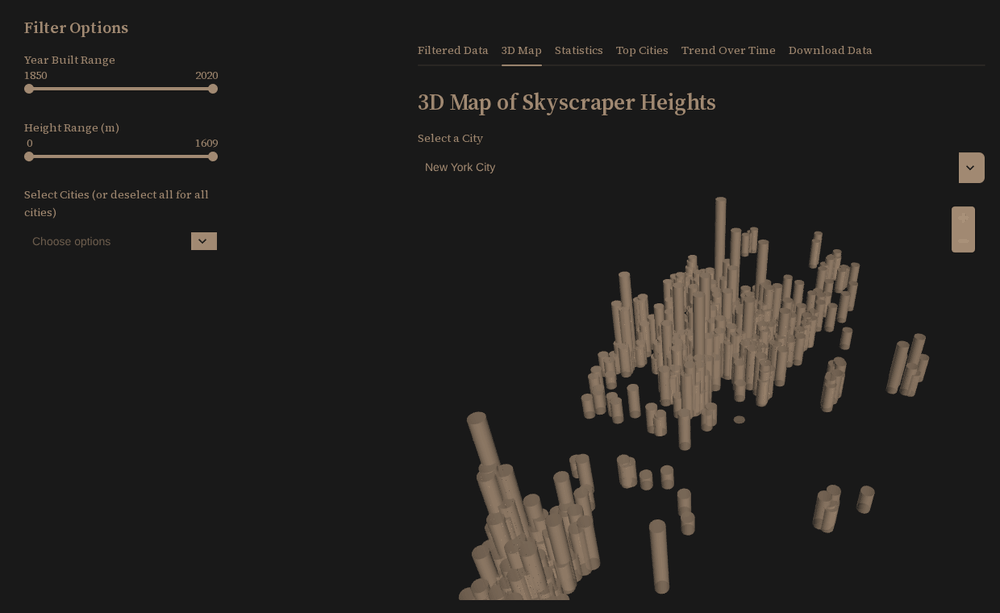

# Skyscrapers Explorer

**A Streamlit dashboard for exploring 2,431 US skyscrapers: filter by year, height, and city, then read the results as a table, a 3D height map, summary statistics, and trend charts, and export the selection as CSV.**
 

 
*The app running locally without a Mapbox key, so the map draws building columns on a plain background.*
 
## Motivation
 
A raw skyscraper CSV is 2,431 rows and 41 columns: easy to store, hard to read. The questions people actually ask are simple. Which cities have the most towers? When did the building booms happen? What does a skyline look like once you plot height instead of listing it?
 
Skyline Lens answers those in one page. Three sidebar filters drive six views, so every question is a slider move away instead of a pandas session.
 
## Quick Start
 
Requires **Python 3.11+**.
 
```bash
git clone https://github.com/amayakmt/skyscrapers-explorer.git
cd skyscrapers-explorer
python -m venv .venv && source .venv/bin/activate   # Windows: .venv\Scripts\activate
pip install -r requirements.txt
streamlit run main.py
```
 
Streamlit opens the dashboard at `http://localhost:8501`.
 
## Usage
 
### Filters
 
The sidebar filters drive every tab.
 
| Filter | What it does |
| --- | --- |
| **Year Built Range** | Keeps buildings by completion year (1850 to 2020, default is the full range). |
| **Height Range (m)** | Keeps buildings by structural height in meters. |
| **Select Cities** | Narrows to one or more cities. Leave it empty to include every city. |
 
### Tabs
 
| Tab | What you get |
| --- | --- |
| **Filtered Data** | The current selection as a table. |
| **3D Map** | Pick a city and see its buildings as 3D columns scaled by height, with a height and city tooltip on hover. |
| **Statistics** | Tallest, shortest, average, and median height, plus the building count. |
| **Top Cities** | Bar chart of the ten cities with the most buildings in the selection. |
| **Trend Over Time** | Buildings completed per year across the selection. |
| **Download Data** | The filtered rows as `filtered_skyscrapers.csv`. |
 
### How to read the data
 
- **All records are US buildings** across about 160 cities. New York City (640 records) and Chicago (419) dominate.
- **Not every record is a finished building.** 2,081 are completed; the rest are under construction, proposed, topped out, demolished, on hold, never completed, or visions. The app does not filter by status, so statistics and charts include all of them. The `status_current` column in the table shows which is which.
- **Buildings with no completion year are excluded.** 118 records have no year, and the year filter drops them even at the full range. The default view shows 2,313 of 2,431 records.
- **Unknown map coordinates are skipped.** The dataset stores missing coordinates as `(0, 0)`, so those buildings appear in the table and charts but not on the 3D map.
- **The Statistics tab ignores records with a height of 0.**
### Configuration
 
The 3D map requests a Mapbox dark basemap, and Mapbox styles need your own API key. Set it before starting the app if the basemap tiles do not load:
 
```bash
export MAPBOX_API_KEY=your_key_here
streamlit run main.py
```
 
Colors come from `.streamlit/config.toml` and a small CSS block at the top of `main.py`.
 
## Dataset
 
`skyscrapers.csv` has 41 fields per building: material, location (city, country, latitude, longitude), 23 purpose flags, statistics (floors above ground, height, number of purposes, rank), and status (current status plus completion and start years). It follows the schema of the [CORGIS Skyscrapers dataset](https://corgis-edu.github.io/corgis/csv/skyscrapers/), whose statistics come from the [Skyscraper Center](https://www.skyscrapercenter.com/). The app drops the purpose flags and ID columns from the displayed table to keep it readable.
 
## Contributing
 
### Clone the repo
 
```bash
git clone https://github.com/amayakmt/skyscrapers-explorer.git
cd skyscrapers-explorer
```
 
### Set up the environment
 
```bash
python -m venv .venv && source .venv/bin/activate
pip install -r requirements.txt
```
 
### Run the app
 
```bash
streamlit run main.py
```
 
The repository has no automated test suite yet. Before opening a pull request, step through all six tabs with a few filter combinations, including a selection that matches nothing.
 
### Use a Dev Container
 
Open the repository in VS Code Dev Containers or GitHub Codespaces. The `.devcontainer` configuration installs the dependencies and starts the app on port 8501.
 
### Project layout
 
```text
main.py                       # Streamlit app: data prep, filters, six tabs
skyscrapers.csv               # Dataset
requirements.txt              # Python dependencies
.streamlit/config.toml        # Theme
.devcontainer/                # Dev Container configuration
```
 
### Deploy your own copy
 
[Streamlit Community Cloud](https://streamlit.io/cloud) can run this app straight from a GitHub repository. Point it at `main.py`.
 
### Submit a pull request
 
Fork the repository and open a pull request to `main` with a focused change.
 
## License
 
The code is released under the [MIT License](LICENSE). The dataset belongs to the CORGIS Datasets Project and the Skyscraper Center, so check their terms before reusing it commercially.